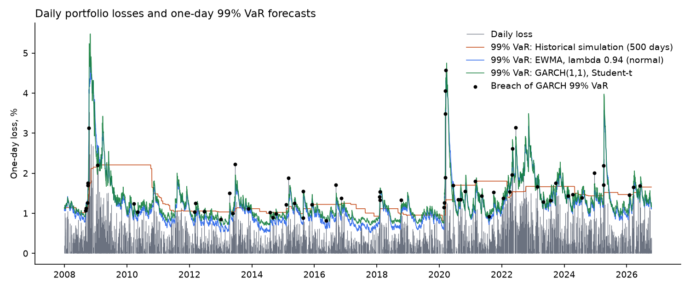
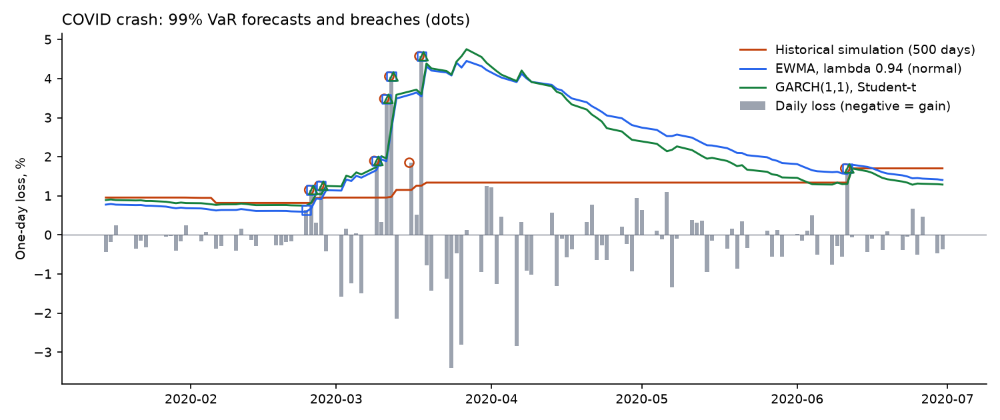
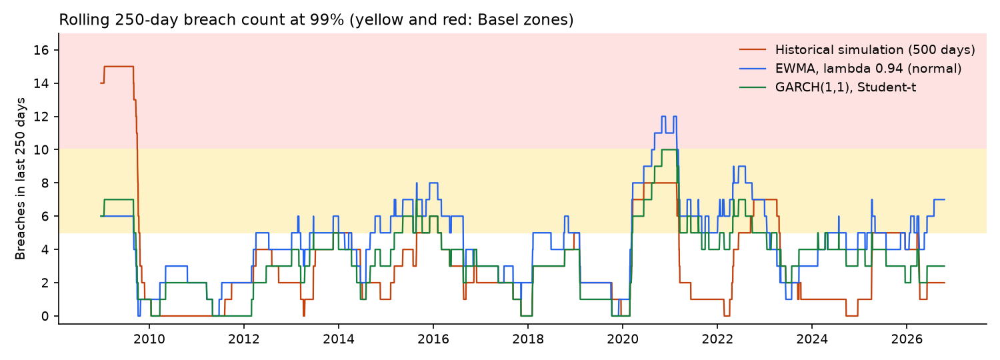
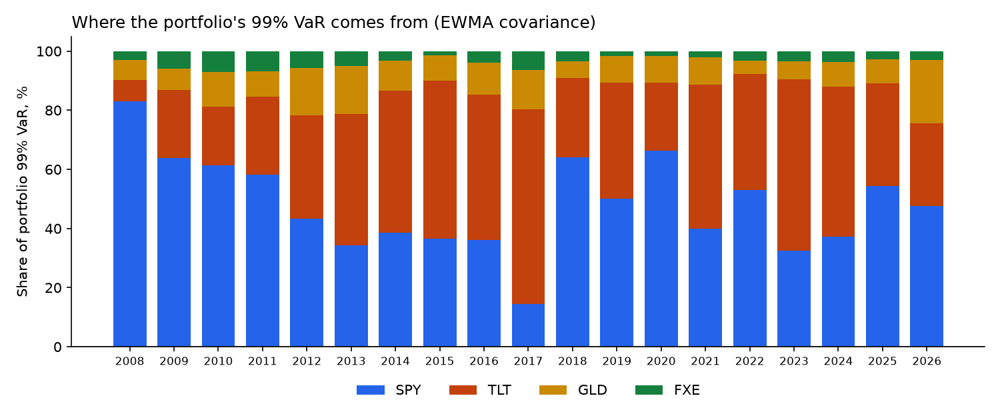

# Multi-Asset Volatility Forecasting and VaR/ES Backtest

How well do standard risk models forecast the next day's loss on a simple multi-asset portfolio, and where do they fail?

The portfolio holds US equities, US Treasuries, gold and the euro (through ETFs). Five models forecast one-day **Value at Risk (VaR)** and **Expected Shortfall (ES)** every day from 2008 onwards, using only data available the evening before. The forecasts are then backtested with the tests a bank risk team or regulator would use.

## Models

| Model | How the forecast is made |
|---|---|
| **Historical simulation** | The 99% VaR is the 99th percentile of the last 500 daily losses; ES is the average of the losses beyond it. No distribution is assumed, but it reacts slowly to a new crisis. |
| **EWMA (RiskMetrics)** | Volatility is an exponentially weighted average of past squared returns (lambda 0.94), with normally distributed returns. Reacts fast, but normal tails are thin. |
| **GARCH(1,1), Student-t** | Volatility follows sigma²ₜ = ω + α r²ₜ₋₁ + β sigma²ₜ₋₁, with fat-tailed Student-t shocks. Parameters are fitted by maximum likelihood on all data up to the forecast date and refitted every 20 trading days. |
| **GJR-GARCH(1,1), Student-t** | As GARCH, plus a term γ r²ₜ₋₁ that applies only after a down day, so losses raise volatility more than gains of the same size (the "leverage effect"). Same fitting and refitting. |
| **Filtered historical simulation (GJR)** | Divides each past return by its GJR-GARCH volatility to get standardised returns, then takes the 99th percentile (and the mean beyond it) of those standardised losses and scales it by tomorrow's volatility. Volatility reacts fast, as in GARCH, but the tail shape comes from the data instead of an assumed distribution. |

GJR-GARCH and filtered historical simulation were added after the first version of this backtest (the first three models only) showed that none passed at 99%. That makes 2008 to 2018 in effect the period the models were selected on, so the results also show 2019 onwards separately as a hold-out test.

Losses are positive numbers, so a 99% VaR of 1.2% means "a one-day loss larger than 1.2% should happen on about 1 day in 100". The 97.5% ES is the risk measure used under the Basel FRTB rules; 99% VaR is the classic one.

## Backtests

- **Kupiec test**: is the share of days with a loss above VaR (a *breach*) equal to 1%?
- **Christoffersen test**: are breaches independent, or does one breach make another more likely the next day? Clustered breaches mean the model is slow to react.
- **Conditional coverage**: both of the above together.
- **Engle-Manganelli dynamic quantile (DQ) test**: can a breach be predicted from the last four days' breaches and the VaR level itself? A stricter check than Christoffersen's.
- **Basel traffic light**: breaches in each rolling 250-day window; 10 or more is the red zone.
- **Acerbi-Szekely Z2 test for ES**: are losses beyond VaR, on average, as large as the ES forecast said? 0 means right; above about 0.70 rejects at the 5% level.

## Key findings

- **None of the three standard models passes the 99% VaR backtest over 2008 to 2026.** Historical simulation, EWMA and GARCH-t breach 62 to 86 times against 47 expected, and their breaches cluster in crises.
- **Filtered historical simulation does best.** It combines GJR-GARCH volatility with the empirical tail of past standardised residuals. With 61 breaches (Kupiec p 0.055) it is the only model that passes both the breach-rate and the Christoffersen independence tests, with the fewest back-to-back breaches (2) and the best ES test (Z2 of 0.15). It still fails the stricter dynamic quantile test (p 0.023).
- **Out of sample, the gain is smaller.** GJR-GARCH and filtered historical simulation were added after the first results, so 2019 to 2026 is the fairer test. There every model breaches too often: filtered HS 31, GARCH 32 and GJR 36 against 20 expected; historical simulation has 24 but they are heavily clustered (independence p 0.002). Out of sample, what filtered HS mainly fixes is clustering, not the breach count.
- **Historical simulation reacts too slowly.** It had 15 breaches against 1.5 expected in the 2008 to 2009 crisis. On the worst day of the test, 18 March 2020 (a 4.57% loss), its 99% VaR was 1.26%, against 4.21% for filtered HS and 3.60% for GARCH.
- **EWMA with normal returns is worst at 99% (86 breaches) but fine at 95%** (239 breaches against 236 expected). The normal distribution describes ordinary days well and the tail badly.
- **The risk decomposition shows the stock-bond hedge weakening.** In the 2008 crisis equities made up 92% of the portfolio's 99% VaR and Treasuries slightly reduced it (SPY-TLT correlation -0.48). In 2022 the correlation was about zero and Treasuries carried 39% of the risk. On the latest day the correlation is +0.21 and Treasuries (41%) contribute more than equities (35%). In 2022 the standard models breached 5 to 7 times against 2.5 expected; filtered HS breached 3 times.
- **Expected Shortfall is not rejected for any model** (all Z2 values below 0.70), so the size of losses beyond VaR was roughly right even where the frequency of breaches was not.

## Results

<!-- RESULTS -->
Test period: **2007-12-31 to 2026-10-16**, 4,729 trading days. Portfolio: 40% SPY (US equities), 40% TLT (US Treasuries 20y+), 10% GLD (Gold), 10% FXE (Euro vs US dollar), rebalanced daily. Expected 99% VaR breaches: **47**.

| | Historical simulation (500 days) | EWMA, lambda 0.94 (normal) | GARCH(1,1), Student-t | GJR-GARCH, Student-t | Filtered historical simulation (GJR) |
|---|---|---|---|---|---|
| 99% VaR breaches (expected 47) | 62 (1.31%) | 86 (1.82%) | 65 (1.37%) | 69 (1.46%) | 61 (1.29%) |
| Kupiec p-value (breach rate = 1%?) | 0.040 | <0.001 | 0.014 | 0.003 | 0.055 |
| Christoffersen independence p-value | <0.001 | <0.001 | 0.014 | 0.101 | 0.245 |
| Conditional coverage p-value | <0.001 | <0.001 | 0.002 | 0.003 | 0.081 |
| Engle-Manganelli dynamic quantile p-value | <0.001 | <0.001 | <0.001 | 0.002 | 0.023 |
| Back-to-back breaches | 8 | 7 | 4 | 3 | 2 |
| Share of 250-day windows in Basel red zone (10+ breaches) | 4.3% | 3.1% | 1.7% | 1.9% | 1.7% |
| 97.5% ES test, Acerbi-Szekely Z2 (0 = right; >0.70 rejects) | 0.26 | 0.45 | 0.19 | 0.17 | 0.15 |
| Average 99% VaR (one-day loss) | 1.39% | 1.21% | 1.30% | 1.27% | 1.31% |
| Average 97.5% ES | 1.47% | 1.22% | 1.33% | 1.30% | 1.35% |
| Verdict on 99% VaR | too many breaches | too many breaches | too many breaches | too many breaches | right rate, but breaches cluster |

Latest GARCH fit (2026-10-06): alpha 0.071, beta 0.917, persistence 0.987, Student-t degrees of freedom 8.7. Latest GJR-GARCH fit: alpha 0.021, gamma (extra effect of a loss) 0.082, beta 0.925.

**By sub-period.** GJR-GARCH and filtered historical simulation were added after the first results (three models, full period) had been seen, so 2008 to 2018 is in effect the period the models were chosen on and 2019 onwards is the fairer, hold-out test.

| Period | Days | Expected | Historical simulation (500 days) | EWMA, lambda 0.94 (normal) | GARCH(1,1), Student-t | GJR-GARCH, Student-t | Filtered historical simulation (GJR) |
|---|---|---|---|---|---|---|---|
| 2008 to 2018 (selection) | 2769 | 28 | 38 (Kupiec 0.062, ind. <0.001) | 44 (Kupiec 0.004, ind. 0.005) | 33 (Kupiec 0.325, ind. 0.063) | 33 (Kupiec 0.325, ind. 0.411) | 30 (Kupiec 0.663, ind. 0.417) |
| 2019 to 2026-10-16 (hold-out) | 1959 | 20 | 24 (Kupiec 0.333, ind. 0.002) | 42 (Kupiec <0.001, ind. 0.072) | 32 (Kupiec 0.010, ind. 0.110) | 36 (Kupiec <0.001, ind. 0.174) | 31 (Kupiec 0.017, ind. 0.097) |
<!-- /RESULTS -->



### Stress periods: 99% VaR breaches

<!-- STRESS -->
| Period | Days | Expected | Historical simulation (500 days) | EWMA, lambda 0.94 (normal) | GARCH(1,1), Student-t | GJR-GARCH, Student-t | Filtered historical simulation (GJR) |
|---|---|---|---|---|---|---|---|
| Global financial crisis (Sep 2008 to Mar 2009) | 146 | 1.5 | 15 | 6 | 7 | 6 | 5 |
| COVID crash (20 Feb to 30 Apr 2020) | 50 | 0.5 | 7 | 7 | 6 | 6 | 6 |
| Rates shock (2022) | 251 | 2.5 | 7 | 7 | 5 | 5 | 3 |

Worst day in the test: **2020-03-18**, a loss of 4.57%. Forecast 99% VaR that morning: historical simulation 1.26%, EWMA 3.55%, GARCH 3.60%, GJR-GARCH 4.10%, filtered HS 4.21%.
<!-- /STRESS -->





### Robustness checks

<!-- ROBUST -->
| Variant | 99% VaR breaches | Kupiec p | Independence p | Z2 |
|---|---|---|---|---|
| Historical simulation, 250 days | 74 of 47 | <0.001 | <0.001 | 0.41 |
| Historical simulation, 1,000 days (from 2009-12-23) | 45 of 42 | 0.678 | <0.001 | 0.01 |
| EWMA, lambda 0.97 | 82 of 47 | <0.001 | <0.001 | 0.45 |
| Historical simulation (500 days), 95% VaR | 255 of 236 | 0.221 | <0.001 | |
| EWMA, lambda 0.94 (normal), 95% VaR | 239 of 236 | 0.865 | 0.027 | |
| GARCH(1,1), Student-t, 95% VaR | 246 of 236 | 0.527 | 0.006 | |
| GJR-GARCH, Student-t, 95% VaR | 248 of 236 | 0.444 | 0.099 | |
| Filtered historical simulation (GJR), 95% VaR | 247 of 236 | 0.485 | 0.092 | |
<!-- /ROBUST -->

## Where the risk comes from: component VaR

The portfolio's 99% VaR split by asset, using component VaR: each asset's contribution is its weight times its covariance with the portfolio, scaled so the four contributions add up exactly to the portfolio VaR.

<!-- DECOMP -->
| Period | SPY share | TLT share | GLD share | FXE share | Portfolio 99% VaR | SPY-TLT correlation |
|---|---|---|---|---|---|---|
| Full test period | 48% | 38% | 10% | 4% | 1.21% | -0.26 |
| Global financial crisis (Sep 2008 to Mar 2009) | 92% | -2% | 4% | 5% | 2.89% | -0.48 |
| COVID crash (20 Feb to 30 Apr 2020) | 81% | 13% | 5% | 0% | 2.95% | -0.54 |
| Rates shock (2022) | 53% | 39% | 4% | 3% | 1.99% | 0.03 |
| Latest day (2026-10-16) | 35% | 41% | 21% | 4% | 1.19% | 0.21 |

Shares are each asset's average contribution to the one-day 99% VaR; they add up to 100%, and a negative share means the asset was hedging the rest of the portfolio. The decomposition uses the EWMA covariance with normal returns (lambda 0.94), the asset-level version of the EWMA model above, because that is the model in which the contributions add up exactly; it inherits that model's thin tails.
<!-- /DECOMP -->



## Validation

`tests/` holds unit tests for the backtests and models: Kupiec and Christoffersen statistics against hand-computed values, the Student-t VaR and ES formulas against a Monte Carlo, the GARCH recursion against a plain loop, a check that no forecast changes when a later return changes (no look-ahead), and a check that the component VaR adds up to the portfolio VaR. `check_arch.py` compares this repo's maximum-likelihood fits with the [`arch`](https://github.com/bashtage/arch) package on the full sample:

<!-- VALID -->
| Model | Fit | omega | alpha | gamma | beta | nu | Log-likelihood |
|---|---|---|---|---|---|---|---|
| GARCH(1,1)-t | this repo | 0.0038 | 0.0707 | 0.0000 | 0.9166 | 8.6917 | -3,599.8 |
| GARCH(1,1)-t | arch package | 0.0037 | 0.0699 | 0.0000 | 0.9175 | 8.7607 | -3,599.0 |
| GJR-GARCH(1,1)-t | this repo | 0.0042 | 0.0207 | 0.0817 | 0.9252 | 9.5549 | -3,571.4 |
| GJR-GARCH(1,1)-t | arch package | 0.0042 | 0.0199 | 0.0810 | 0.9265 | 9.6509 | -3,570.3 |

Full sample of 5,229 daily portfolio returns in percent, zero mean. The two fits start the variance recursion differently (this repo: sample variance; `arch`: an exponentially weighted backcast), so small differences in parameters and log-likelihood are expected.
<!-- /VALID -->

## Limitations

- **One portfolio, fixed weights.** Daily rebalancing to fixed weights ignores trading costs and is a simplification; real portfolios drift and trade.
- **ETF prices, US hours.** All four ETFs trade in New York, so the test does not deal with asynchronous closing times across markets.
- **Portfolio-level models.** Each model is applied to the portfolio's return series directly. A full multivariate model (for example DCC-GARCH) would capture changing correlations between stocks and bonds, which matters in a year like 2022.
- **Free data.** Adjusted prices come from Yahoo Finance and can contain errors.
- **Backtests have low power.** With 1% VaR and a few thousand days, the tests can only reject models that are clearly wrong.

## Run it

```bash
pip install -r requirements.txt
python download.py     # daily adjusted prices from Yahoo Finance (2006-01-03 to 2026-10-16) into data/
python backtest.py     # forecasts, backtests, component VaR -> results/, charts/ and the sections above
python check_arch.py   # compare the GARCH fits with the arch package
pytest                 # unit tests
```

## Files

| File | What it does |
|---|---|
| `download.py` | Downloads ETF prices with `yfinance` |
| `common.py` | Portfolio definition and daily returns |
| `models.py` | Historical simulation, EWMA, GARCH(1,1)-t, GJR-GARCH(1,1)-t and filtered historical simulation forecasts of VaR and ES |
| `backtest.py` | Kupiec, Christoffersen, DQ, traffic light and Z2 tests; sub-periods; stress periods; robustness; charts |
| `decompose.py` | Component VaR by asset from the EWMA covariance matrix |
| `check_arch.py` | Compares the GARCH and GJR-GARCH fits with the `arch` package |
| `tests/` | Unit tests (`pytest`) |
| `results/` | Forecasts, fitted GARCH and GJR parameters, backtest statistics and component VaR as CSV |
